  I build the user-facing side of AI products: streaming chat interfaces, accessible component libraries and the <b>React</b> and <b>TypeScript</b> codebases behind them.

  <a href="https://www.luccinmasirika.com">Portfolio</a> &nbsp;·&nbsp;
  <a href="https://www.luccinmasirika.com/Luccin-Masirika-Resume.pdf">Résumé</a> &nbsp;·&nbsp;
  <a href="https://www.linkedin.com/in/luccin-masirika">LinkedIn</a> &nbsp;·&nbsp;
  <a href="https://x.com/luccinmasirika">X</a> &nbsp;·&nbsp;
  <a href="mailto:luccinmasirika@gmail.com">Email</a>

---

### What I work on

- **AI interfaces**: streaming chat over SSE and WebSockets, LLM-driven UI (buttons, carousels, lists), prompt management, provider setup for OpenAI, Azure OpenAI and Mistral
- **Accessibility**: WCAG and RGAA work validated with screen reader users, VoiceOver, focus management, live regions
- **Frontend architecture**: design systems on Radix UI and Storybook, Module Federation micro-frontends, Vue 2 to React migrations, embeddable widgets isolated with Shadow DOM
- **Quality**: Jest, Vitest, Playwright, Cypress, jest-axe, CI that actually runs every suite

### Building

- **[Molakisi](https://www.molakisi.com)**: exam-prep app for high school students in DR Congo. Works offline, has an AI tutor in French, and its video lessons are generated from code. Founder and sole developer.

### Open source

Code merged into two of the largest projects in their ecosystems.

<!-- OSS:START -->

- **87.5k ★** &nbsp; [rtk-ai/rtk](https://github.com/rtk-ai/rtk) &nbsp;`Rust` 
  Cargo JSON diagnostics across build, check, test & clippy — [#2422](https://github.com/rtk-ai/rtk/pull/2422), merged.
- **79.4k ★** &nbsp; [caddyserver/caddy](https://github.com/caddyserver/caddy) &nbsp;`Go` 
  Repeated `hide` subdirectives now append instead of overwriting — [#7817](https://github.com/caddyserver/caddy/pull/7817), merged.

<!-- OSS:END -->

### Tools I wrote

- **[s3rsync](https://github.com/luccinmasirika/s3rsync)**: streaming S3 to S3 copier, about 2× rclone on small objects in my benchmarks
- **[sweep](https://github.com/luccinmasirika/sweep)**: safe, interactive disk cleanup for macOS

### Stack

8 years shipping production web apps · Remote · UTC+2
